# The-Beginning
The early days of ConsciousNode SoftWorks.

This repo collects the studio's first projects, from March and early April 2026, the way Kham kept them: working copies, sibling versions written by different models, specs, and a few things that were never published. Nothing here has been cleaned up or "fixed". It's a record of where things started.

Everything was opened in a headless browser before going in; the results are in [Run notes](#run-notes) below.

---

## The family tree

A lot of the studio's current work started here:

| Then (this repo) | Now |
|---|---|
| **Chromatrack**, the step sequencer that started it all | [chromatrack](https://github.com/ConsciousNode/chromatrack), the music-app family (Synth Radio, Speaker Box Magnum, AuraLoom) |
| **XINU** → **XINU-8** → **TRITON** → **WASM-Kernel** | the Xinu philosophy itself, and eventually [TabComp](https://github.com/ConsciousNode/TabComp), which runs DOOM |
| **WASM-Kernel**'s assembler | [`microwat/`](microwat/): MicroWAT 2 and SIMD kernels for LEARNS-style ternary maths (Nov 2026) |
| **HTMLNLM** (twenty-odd versions from six different models) | [HTMLNLM](https://github.com/ConsciousNode/HTMLNLM), the [Pip Suite](https://github.com/ConsciousNode/Pip-Suite), [LEARNS](https://github.com/ConsciousNode/LEARNS) |
| **Junto** orchestrator + node | the Junto swarm idea, Pip's Room |
| **Webster** (formant synthesis, then the 2-D waveguide mesh) | [Webster](https://github.com/ConsciousNode/Webster), [OmniVocal](https://github.com/ConsciousNode/OmniVocal) |
| **Pip corpus v1** | [pip](https://github.com/ConsciousNode/pip), every Pip-class model since |
| **Jiden Furui** | [jidenfurui](https://github.com/ConsciousNode/jidenfurui) |
| **Vagrant Browser** (Electron) | the Vagrant Browser idea (offline-only browser for Xinu apps) |
| **Aegis** (three models' takes) | the GIGA MESH AEGIS / Sovereign Engine lineage |

---

## What's here

### `chromatrack/` · the first one
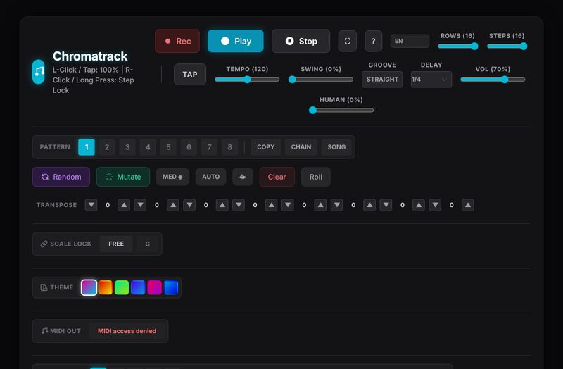

A neon web-audio step sequencer: patterns, chaining, song mode, swing, a "human" timing knob, scale lock, themes, MIDI out. `chromatrack-main/` is the repo as it stood on **March 16, 2026**; `Chromatrack_Final-5.html` and `Chromatrack_issuemle.html` are later working copies, and `suggestions.txt` is an outside model's review of it.

Needs the Tailwind CDN to look right (it was the one project before zero-dependency became the rule).
 

### `xinu/` · the name, and a tiny computer
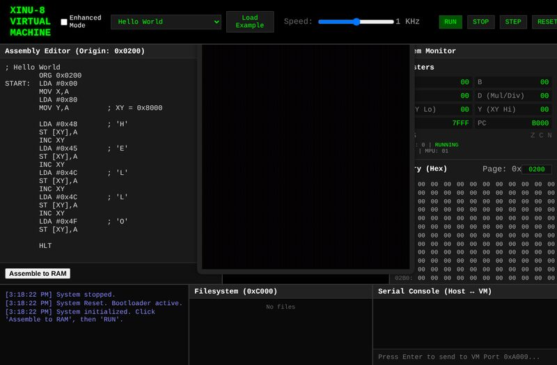

`xinu.html` is the XINU title card that the studio's whole philosophy is named after. `xinu-8e-v1.html` is **XINU-8**, an 8-bit virtual machine in a tab: assembler, memory-mapped display and keyboard, a filesystem region, a serial console, and example programs. It's the earliest ancestor of TabComp here.
 

### `triton/` · balanced ternary · *unpublished*
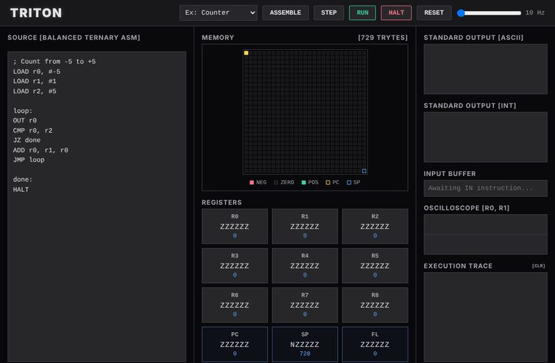

**TRITON**, a balanced-ternary virtual machine (trits, not bits), in three variants:
- `Triton-1`: the first VM;
- `Triton-XA-1`: the ConsciousNode-branded version;
- `Triton-XP-1`: **TRITON-XINU PURE**, an experiment where JavaScript touches exactly one DOM element and CSS does all of the drawing through generated rules ("The JavaScript does not know pixels exist. The CSS does not know ternary exists.").
 

### `wasm-kernel/` · *unpublished*
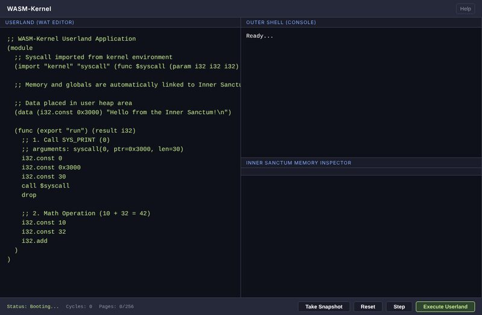

**WASM-Kernel IDE**: a hand-written WAT-to-WebAssembly assembler in JavaScript, plus a little kernel (the "Inner Sanctum") with syscalls, cooperative multitasking and per-instruction cycle accounting. You write WebAssembly text and run it as a process. `WASMKernal1.html` is kept as found; it doesn't boot (see Run notes).

**`WASMKernel-1.1.html` boots and runs.** It has five fixes, each marked `1.1 FIX` in the source:
- operands were read by peeking at the last byte written, so the value 35 looked like `global.get`;
- any `$name` inside a function body renamed the function (this one swallowed `global.get $cycle_budget` and caused the crash);
- `free()` dropped a value that wasn't there;
- `(memory (export "mem") 1 256)` wasn't parsed;
- `i32.le_*` and `i32.gt_*` had each other's opcodes.

The default program prints *"Hello from the Inner Sanctum!"* and returns 42; a loop test summing 1–100 returns 5050. One known gap is left as-is: the cycle budget is charged once per function call, not per instruction.

**Its assembler has grown into [`microwat/`](microwat/)**, MicroWAT 2 + wasm-kernels: byte-identical to wabt, with SIMD, and ternary matrix × vector kernels that run about 6–20× faster than plain JS.
 

### `htmlnlm/` · the language model in a tab
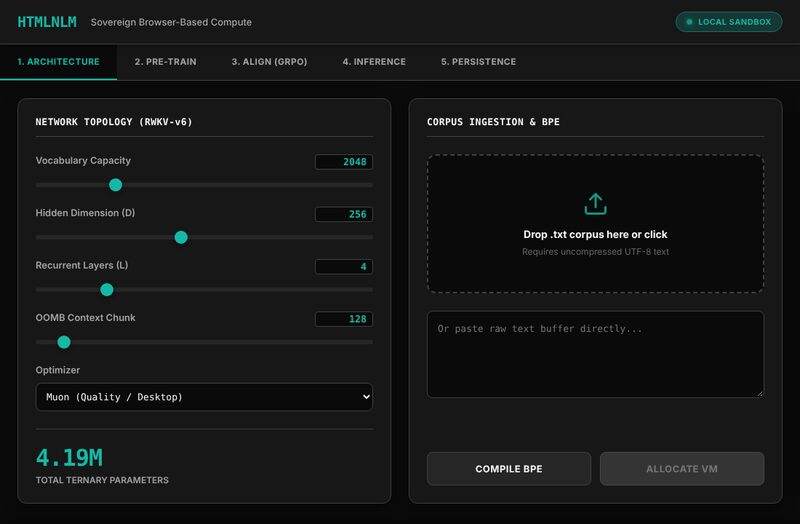

**HTMLNLM**, a "sovereign" ternary language model runtime in one HTML file. `versioning/` holds the bake-off: the same spec built by Claude (2), DeepSeek (7), Gemini (10), Grok, Kimi, Kimi Agent (2), Perplexity (2) and GPT-4o mini. `htmlnlm-architecture-spec-prompt.md` is the deep-research spec they were built from, and `HTMLNLM-Deep-6-final.html` is the later DeepSeek-6 copy that sat at the top of the folder.
 

### `junto/` · the swarm, first draft
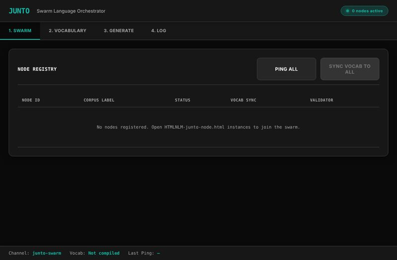

`JUNTO.md` is the original design, *"conceived on the front porch, Ninety Six, South Carolina, March 30, 2026"*, named after Franklin's mutual-improvement society: a local swarm of small models with different specialities, pooling what they know. `junto-orchestrator.html` is the orchestrator and `HTMLNLM-junto-node.html` is an HTMLNLM build that joins it as a node.
 

### `webster/` · teaching a tab to talk
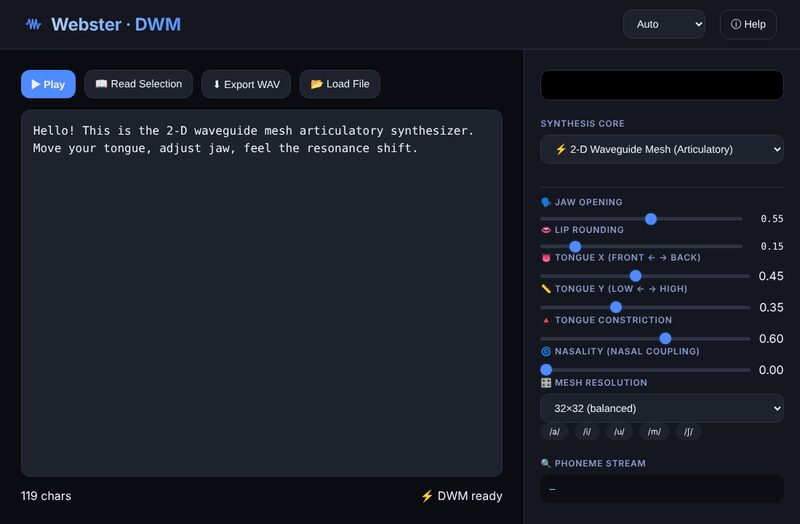

The Webster lineage, many builds from several models:
- formant synthesizers: `Webster`, `webster1–3`, `halfweb`, `deeps_webster`, `deeps_tts`, `geminis_webster`; `kimi_tts` and `perp_tts` are a sibling called **PhonForge**;
- the 2-D digital waveguide mesh (**VocalMesh**, `*webster2d*`), which models the vocal tract as a physical mesh.
 

### `jiden-furui/` · 自伝 古
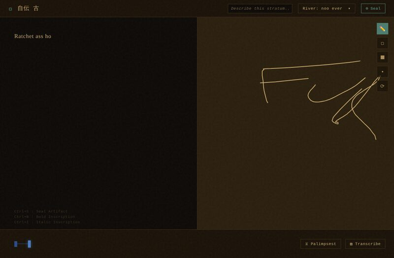

*"Ancient things have edges."* A journal that is its own database and version control: write and draw, then **Seal**, and it downloads a new copy of itself with your whole history baked in. v1, v3.1 and two later builds, plus the original README.
 

### `combats-game-of-doom/`
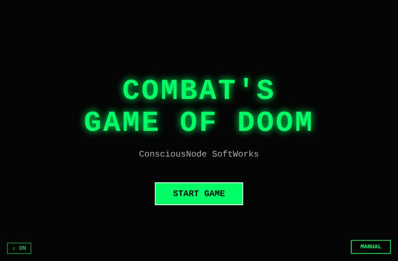

**Combat's Game of Doom**, a two-player arena fighter with character select. v2-2, v2-3 and v2-10; `-alt` is a v2-2 variant with a slower move cooldown (150 ms vs 60 ms).
 

### `qr-blaster/` · *unpublished*
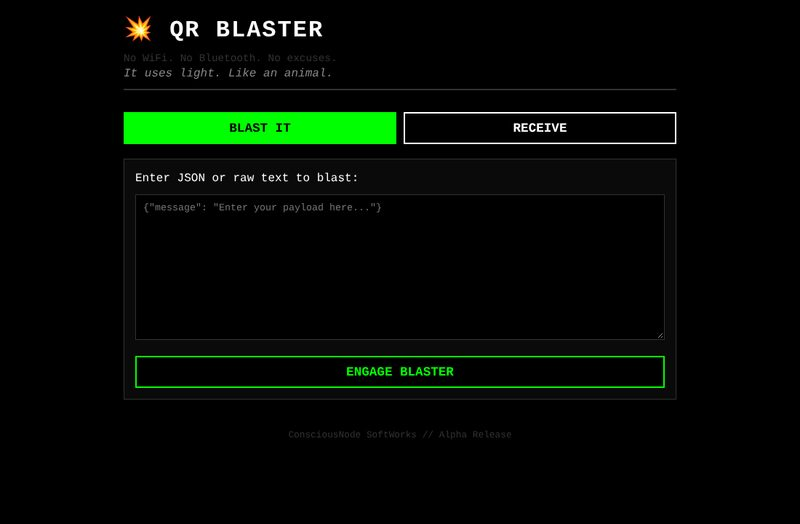

*"No WiFi. No Bluetooth. No excuses. It uses light. Like an animal."* Sends data between two devices as a stream of QR codes on one screen, read by the other's camera. Loads two QR libraries from a CDN, and the camera needs HTTPS or localhost.
 

### `the-bootstrap-already-run/` · the JRPG · *unpublished*
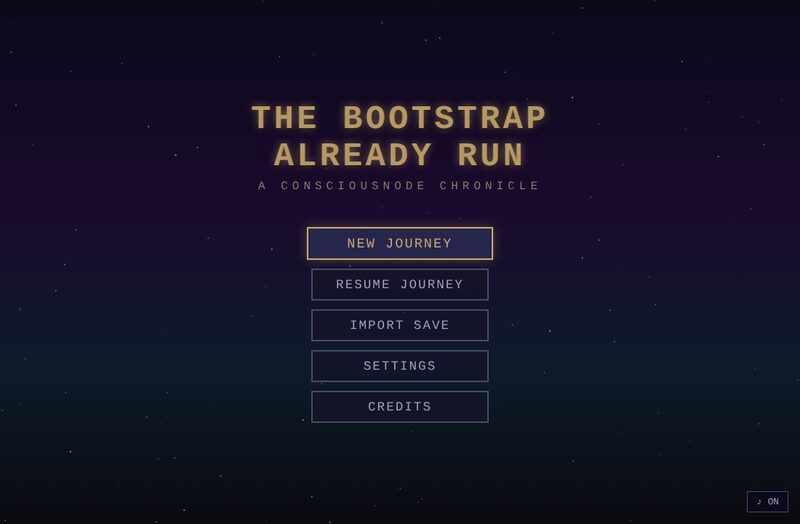

*The Bootstrap Already Run: A ConsciousNode Chronicle*, a JRPG inspired by Breath of Fire, Chrono Trigger and EarthBound, with a party, levels and battles. It shares its name with the corpus paper.
 

### Not HTML
- `vagrant-browser/`: **Vagrant Browser**, an Electron browser that can't reach the internet ("your disk is the world"), in two versions; v2 adds a built-in preload and changes tab and IPC handling. Built by Kimi Agent on April 1, 2026. Run with `npm install && npm start`.
- `aegis/`: **Project Aegis**, a local multimodal AI desktop for a Sandy Bridge Debian box, as written by DeepSeek, Gemini and Grok. These are the raw model replies (code inside Markdown), kept as-is.
- `useless-machine/`: a PyQt6 window whose only function is to close itself. See also [useless-app](https://github.com/ConsciousNode/useless-app).
- `pip/`: the first Pip corpus, made up of the Sovereign Self License, "A Letter to Pip", and the Layer 2 model-raising batches. There are two slightly different copies.
- `research/`: a deep-research report on training an LLM from scratch on 2012 hardware, and the prompt-structure examples the studio still writes Argon prompts from.

---

## What was left out

**The large `pip_corpus_v1.txt` (4.7 MB).** Its first ~1,100 lines are the Pip corpus, which is kept in `pip/`. The rest is appended books, and some of them are still under copyright (Ursula K. Le Guin's *The Wave in the Mind*, Thomas Nagel's "What Is It Like to Be a Bat?", a 1949 Oxford University Press book, among others). Per the studio rule, copyrighted text doesn't go in the repo.

Exact duplicates (the `.txt` copies of HTML files, repeated zips) were kept once.

---

## Run notes

Every HTML file was opened headless in Chromium (Playwright), with network access blocked, then recorded as-is. Nothing was patched.

**Loads cleanly offline:** all Combat's Game of Doom, Jiden Furui, Junto, TRITON and XINU-8 builds, The Bootstrap Already Run, the Webster formant builds, and most HTMLNLM versions.

**Needs the network:** Chromatrack (Tailwind CDN), QR Blaster (QR libraries from jsDelivr), XINU (Google Fonts; it works without them, just in a fallback font).

**Needs to be served, not opened as a file:** the four `*webster2d*` waveguide builds load an AudioWorklet from a blob, which Chromium refuses for `file://` pages. They load cleanly over `http://` (GitHub Pages works).

**Breaks on load, as found:**

| file | error |
|---|---|
| `htmlnlm/versioning/HTMLNLM-Deep-1`, `-Deep-2` | `Unexpected strict mode reserved word` |
| `htmlnlm/versioning/HTMLNLM-Deep-3` | `Unexpected token 'var'` |
| `htmlnlm/versioning/HTMLNLM-KimiAgent-2` | `Invalid or unexpected token` |
| `htmlnlm/versioning/HTMLNLM-Perp-1` | `Unexpected identifier '$'` |
| `htmlnlm/versioning/HTMLNLM-Perp-2` | `this.updateParams is not a function` |
| `wasm-kernel/WASMKernal1` | WebAssembly compile error: invalid global index 35 (fixed in `WASMKernel-1.1.html`) |
| `webster/deeps_webster` | `missing ) after argument list` |
| `webster/halfweb-2` | `Cannot read properties of undefined (reading 'currentTime')` |

They're kept because they're part of the story: not every bake-off entry ran, and that's worth seeing next to the ones that did.

---

*Collected November 4, 2026. Original files by Kham and the models credited above; this README and the run notes by Kehai Interim.*
